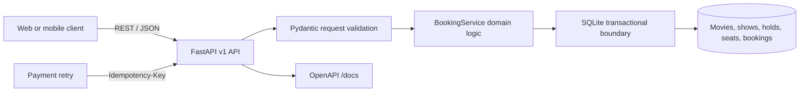
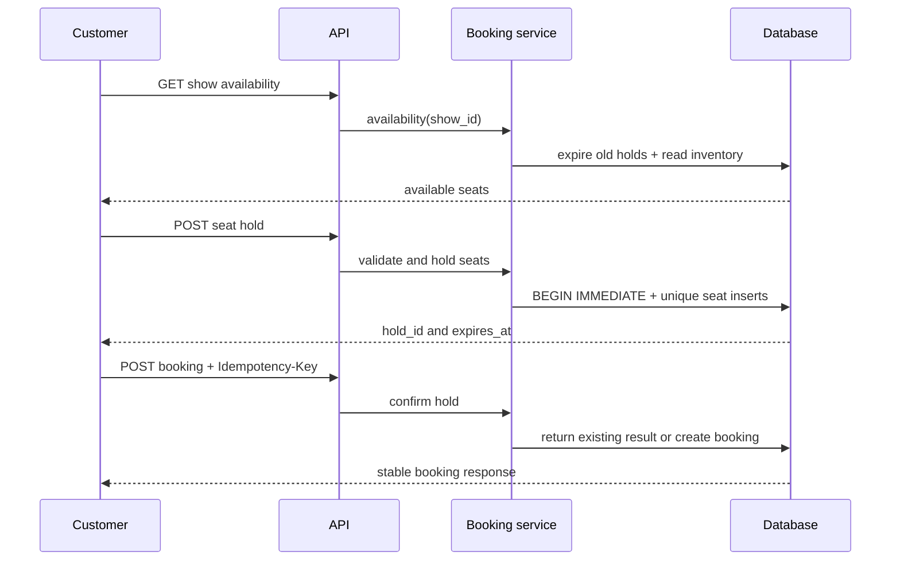

# BookMyMovie

**A concurrency-safe movie seat inventory and booking API designed around the hardest part of ticketing: preventing double bookings.**

[](https://github.com/haarikaalla/Movie-Ticket-Booking/actions/workflows/ci.yml)


BookMyMovie is an end-to-end backend service for show inventory, temporary seat holds, availability, and idempotent booking confirmation. It upgrades a command-line learning exercise into a structured, tested, containerized API with transactional guarantees and a versioned service contract.

The design targets the failure modes that matter in real booking systems: competing customers selecting the same seat, abandoned checkouts blocking inventory forever, payment retries creating duplicate orders, invalid seat numbers, and inconsistent availability reads.

## Why this project matters

Ticket booking is a deceptively difficult inventory problem. During popular releases, many customers may request the same limited seats at nearly the same time. A correct system must temporarily reserve inventory, release abandoned holds, reject conflicts, and make retries safe.

BookMyMovie provides a compact reference implementation of those concepts:

- transactional seat holds serialize competing inventory changes;
- database uniqueness rules prevent a seat from being held twice;
- five-minute hold expiration releases abandoned inventory;
- idempotency keys make booking confirmation safe to retry;
- strict request models reject malformed data before business logic runs;
- versioned REST endpoints and OpenAPI documentation support client integration;
- tests exercise the business invariants, not only successful responses.

## Core capabilities

| Capability | Implementation | Business impact |
| --- | --- | --- |
| Live availability | Calculates unclaimed seats for a show | Customers see usable inventory |
| Temporary holds | UUID-based hold with UTC expiration | Checkout gets a protected reservation window |
| Conflict prevention | Transaction + unique `(show_id, seat_number)` constraint | Eliminates double booking at the database boundary |
| Automatic release | Expired holds are cleared during inventory operations | Abandoned carts do not permanently consume seats |
| Idempotent confirmation | Unique `Idempotency-Key` | Network or payment retries return the same booking |
| Validated API | FastAPI and Pydantic v2 | Invalid requests receive consistent errors |
| Portable runtime | Python package and Docker image | Runs locally, in CI, or as a container |

## System architecture



### Booking lifecycle



## Technology stack

- **Python 3.11+** — application and domain layer
- **FastAPI** — high-performance ASGI API and generated OpenAPI schema
- **Pydantic v2** — typed request constraints and serialization
- **SQLite** — zero-infrastructure relational persistence and transactions
- **Uvicorn** — production-capable ASGI server
- **Hatchling** — modern package build system
- **pytest + HTTPX** — service and API test tooling
- **Ruff** — linting and code-quality enforcement
- **Docker** — reproducible deployment with a persistent data volume
- **GitHub Actions** — tests and linting on every push and pull request

## API reference

Start the application and open `http://127.0.0.1:8000/docs` for the interactive OpenAPI console.

| Method | Endpoint | Purpose |
| --- | --- | --- |
| `GET` | `/health` | Service health and current UTC time |
| `GET` | `/v1/shows/{show_id}/availability` | List currently available seat numbers |
| `POST` | `/v1/holds` | Reserve one to ten seats temporarily |
| `POST` | `/v1/bookings` | Confirm an active hold idempotently |

### Create a hold

```bash
curl -X POST http://127.0.0.1:8000/v1/holds \
  -H 'Content-Type: application/json' \
  -d '{
    "show_id": 1,
    "customer_id": "customer-42",
    "seat_numbers": [4, 5]
  }'
```

Successful response:

```json
{
  "hold_id": "a-generated-uuid",
  "show_id": 1,
  "seats": [4, 5],
  "expires_at": "2026-10-17T12:05:00+00:00"
}
```

### Confirm a booking safely

```bash
curl -X POST http://127.0.0.1:8000/v1/bookings \
  -H 'Content-Type: application/json' \
  -H 'Idempotency-Key: payment-attempt-123' \
  -d '{"hold_id": "a-generated-uuid"}'
```

Repeating the request with the same idempotency key returns the original booking instead of creating another one.

## Quick start

### Prerequisites

- Python 3.11+
- Git

### Install and run

```bash
git clone https://github.com/haarikaalla/Movie-Ticket-Booking.git
cd Movie-Ticket-Booking

python -m venv .venv
source .venv/bin/activate            # Windows: .venv\Scripts\activate
python -m pip install --upgrade pip
pip install -e '.[dev]'

uvicorn bookmymovie.api:app --reload
```

The API creates `bookings.db` automatically. Set `BOOKING_DB` to use another path:

```bash
BOOKING_DB=/tmp/bookmymovie.db uvicorn bookmymovie.api:app --reload
```

Movies and shows can be seeded through `BookingService.create_movie()` and `create_show()` before exercising customer endpoints. This keeps catalogue administration separate from the public booking contract.

## Docker

```bash
docker build -t bookmymovie .
docker run --rm -p 8000:8000 -v bookmymovie-data:/data bookmymovie
```

The container stores its SQLite database at `/data/bookings.db`, backed by the named volume.

## Data integrity model

The relational schema makes correctness enforceable:

- foreign keys link shows to movies, holds to shows, and bookings to holds;
- checks require positive durations and seat counts;
- one composite uniqueness constraint protects each seat within a show;
- each hold can create at most one booking;
- each idempotency key can create at most one booking;
- hold status is restricted to `active`, `confirmed`, or `expired`.

Application transactions use `BEGIN IMMEDIATE` so competing SQLite writers cannot both observe the same seat as available and then reserve it independently.

## Error behavior

| Status | Meaning |
| --- | --- |
| `201` | Hold or booking created |
| `404` | Show does not exist |
| `409` | Seat is unavailable, hold is missing, or hold expired |
| `422` | Request or seat selection is invalid |

## Quality and testing

```bash
ruff check src tests
pytest
```

Tests verify inventory removal, double-booking rejection, idempotent confirmation, and invalid-seat protection. GitHub Actions recreates the environment and runs the same checks for each push and pull request.

## Project structure

```text
.
├── .github/workflows/ci.yml       # automated lint and tests
├── src/bookmymovie/
│   ├── api.py                     # FastAPI routes and request models
│   ├── database.py                # schema and connection management
│   └── service.py                 # transactions and booking rules
├── tests/test_booking_service.py  # business-invariant tests
├── Dockerfile                     # containerized API runtime
├── pyproject.toml                 # package and tool configuration
└── LICENSE
```

## Scaling roadmap

SQLite is ideal for a self-contained demonstration. A production evolution would preserve the API and domain rules while adding:

- PostgreSQL with row-level locking or atomic conflict handling;
- payment-provider webhooks and refund workflows;
- transactional outbox events for email, analytics, and fulfilment;
- catalogue and show-management APIs with role-based access;
- distributed expiration workers and reservation metrics;
- authentication, authorization, rate limiting, and audit logs;
- tracing, structured logs, dashboards, and load tests;
- a responsive customer frontend consuming the versioned API.

## License

This project is available under the [MIT License](LICENSE).
