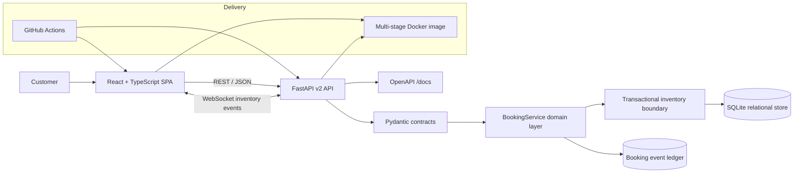
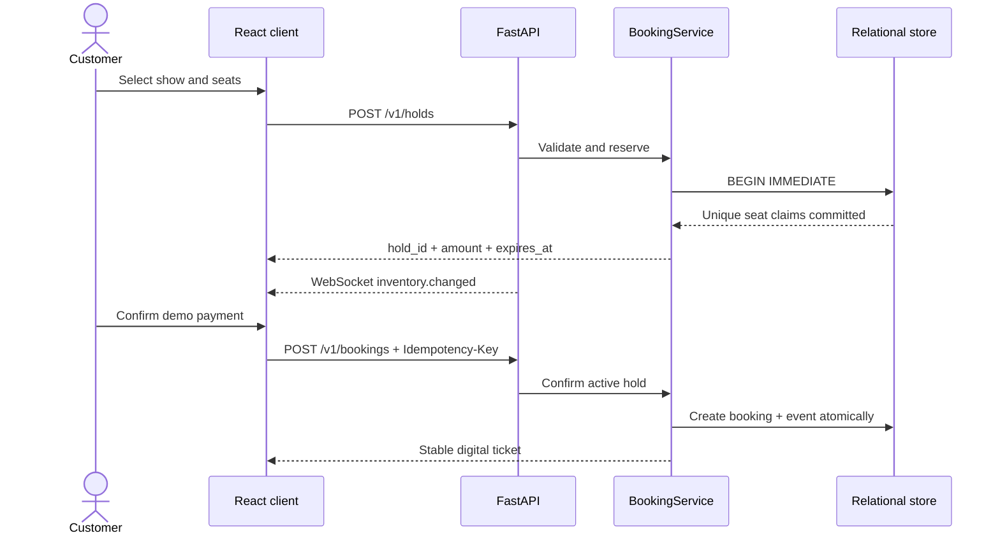

<div align="center">

# BookMyMovie

### Real-time cinema discovery, seat reservation, checkout, and ticketing

[](https://github.com/haarikaalla/Movie-Ticket-Booking/actions/workflows/ci.yml)


**A production-minded full-stack booking platform built around the hardest part of ticketing: maintaining correct inventory while customers compete for the same seats.**

</div>

---

## What this project demonstrates

BookMyMovie is not a static booking form. It is an end-to-end transaction workflow with a responsive customer interface, versioned API, relational domain model, live inventory channel, expiring reservations, tiered pricing, simulated payment confirmation, and automated quality gates.

The implementation addresses the failure modes that matter in a real ticketing system:

- two customers attempting to reserve the same seat;
- abandoned checkouts blocking inventory indefinitely;
- payment retries creating duplicate bookings;
- stale seat maps during high-demand sales;
- invalid seat selections and malformed client input;
- frontend and backend drifting into incompatible contracts;
- an application that works locally but cannot be packaged consistently.

## Product experience

The React application provides a complete customer journey:

1. Discover a curated film catalogue and search by title or genre.
2. Compare formats, theatres, showtimes, ratings, languages, and starting prices.
3. Open a live auditorium map with Classic, Prime, and Recliner pricing.
4. Select up to ten available seats and see the total update immediately.
5. Reserve the seats behind a five-minute checkout timer.
6. Choose a simulated UPI, card, or wallet payment experience.
7. Receive a digital ticket with booking and payment references.

The interface is responsive across desktop and mobile, keyboard accessible, and designed with clear loading, empty, conflict, and error states.

> Payment is intentionally simulated. No card or UPI data is collected and no real funds are moved.

## Architecture



### Booking lifecycle



## Engineering highlights

| Concern | Implementation | Why it matters |
| --- | --- | --- |
| Double-booking prevention | Transaction plus unique `(show_id, seat_number)` database constraint | Correctness does not depend on an in-memory check |
| Checkout reservations | UUID hold with UTC expiry | Customers receive a protected purchase window |
| Automatic inventory recovery | Expired hold cleanup during inventory operations | Abandoned checkouts release seats |
| Safe payment retry | Unique idempotency key bound to one hold | Retries return the original booking instead of duplicating it |
| Live availability | Show-scoped WebSocket event channel | Open clients refresh when inventory changes |
| Tiered pricing | Server-owned Classic, Prime, and Recliner price calculation | The client cannot define the amount it pays |
| API safety | Pydantic constraints and consistent 4xx responses | Invalid data is rejected before domain execution |
| Auditable workflow | Immutable confirmation event with payment metadata | Important transitions have an evidence trail |
| Production packaging | Multi-stage frontend build and non-root Python runtime | One small container serves the UI and API |
| Quality gates | Python lint/tests plus TypeScript build/frontend tests | Both halves are validated on every pull request |

## Technology stack

### Frontend

- React with TypeScript
- Vite production build
- responsive CSS design system
- native WebSocket inventory updates
- Vitest unit tests

### Backend

- Python 3.11+
- FastAPI and generated OpenAPI documentation
- Pydantic v2 request validation
- transactional SQLite persistence
- WebSocket event broadcasting
- pytest, HTTPX, and Ruff

### Delivery

- multi-stage Docker build
- non-root runtime and container health check
- persistent Docker volume
- GitHub Actions backend and frontend jobs

## Quick start

### One-command production preview

```bash
docker compose up --build
```

Open:

- application: <http://localhost:8000>
- API documentation: <http://localhost:8000/docs>
- health endpoint: <http://localhost:8000/health>

The database is automatically initialized and populated with a demo catalogue. Data is preserved in the `booking-data` Docker volume.

### Local development

Backend:

```bash
python -m venv .venv
source .venv/bin/activate          # Windows: .venv\Scripts\activate
pip install -e '.[dev]'
uvicorn bookmymovie.api:app --reload
```

Frontend, in another terminal:

```bash
cd frontend
npm install
npm run dev
```

The Vite development server runs at <http://localhost:5173> and proxies API requests to port `8000`.

## API surface

| Method | Endpoint | Purpose |
| --- | --- | --- |
| `GET` | `/health` | Runtime health and service version |
| `GET` | `/v1/catalogue` | Searchable, city-filtered films and showtimes |
| `GET` | `/v1/shows/{id}/seats` | Priced seat map with live states |
| `GET` | `/v1/shows/{id}/availability` | Compact list of currently available seat numbers |
| `WS` | `/v1/shows/{id}/events` | Show-scoped inventory change notifications |
| `POST` | `/v1/holds` | Atomically reserve one to ten seats |
| `GET` | `/v1/holds/{id}` | Retrieve the authoritative checkout state |
| `DELETE` | `/v1/holds/{id}` | Release an abandoned checkout immediately |
| `POST` | `/v1/bookings` | Confirm a hold with an `Idempotency-Key` |
| `GET` | `/v1/bookings/{id}` | Retrieve a confirmed digital ticket |

Interactive request and response schemas are available in Swagger UI at `/docs`.

## Data integrity model

The relational schema makes business invariants enforceable:

- shows belong to valid movies;
- holds belong to valid shows;
- a seat can appear only once per show while held or booked;
- each hold can produce at most one booking;
- each idempotency key can produce at most one booking;
- hold and booking status values are constrained;
- durations, seat counts, prices, and ratings have database checks;
- booking events reference valid bookings.

SQLite uses `BEGIN IMMEDIATE` for inventory mutations. Two writers cannot both observe the same seat as available and reserve it. The domain contract can later move to PostgreSQL row locking without changing the customer-facing API.

## Testing

Run every local quality gate:

```bash
ruff check src tests
pytest

cd frontend
npm test
npm run build
```

The current suite contains **13 passing tests** across backend and frontend. It covers catalogue grouping, seat labels and tiers, inventory removal, conflicting holds, idempotent confirmation, idempotency misuse, hold release, invalid seats, API error behavior, the complete customer journey, and frontend pricing.

## Repository structure

```text
.
├── frontend/
│   ├── src/
│   │   ├── App.tsx             # complete booking journey
│   │   ├── api.ts              # typed API client
│   │   ├── types.ts            # shared frontend domain types
│   │   └── styles.css          # responsive visual system
│   └── vite.config.ts          # development proxy + production bundle
├── src/bookmymovie/
│   ├── api.py                  # routes, WebSocket hub, SPA delivery
│   ├── database.py             # schema, migrations, connection lifecycle
│   └── service.py              # catalogue, inventory, checkout, ticketing
├── tests/
│   ├── test_api.py             # end-to-end API journeys
│   └── test_booking_service.py # domain and concurrency invariants
├── .github/workflows/ci.yml    # independent frontend/backend quality jobs
├── Dockerfile                  # multi-stage, non-root production image
└── docker-compose.yml          # one-command deployment
```

## Production evolution

The current implementation deliberately keeps infrastructure local and reviewable. A larger deployment would retain the API and invariants while introducing:

- PostgreSQL with row-level locking;
- Redis reservation-expiry workers and distributed event delivery;
- an external payment gateway with signed webhooks and refunds;
- OAuth/OIDC authentication and role-based theatre administration;
- transactional outbox events for notifications and analytics;
- OpenTelemetry traces, Prometheus metrics, and load testing;
- CDN-hosted frontend assets and horizontally scaled API instances.

## License

Released under the [MIT License](LICENSE).
