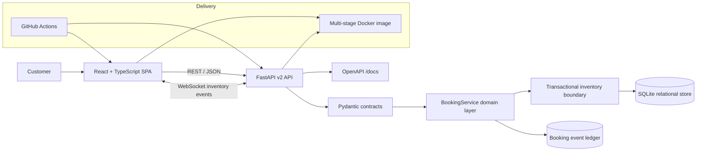
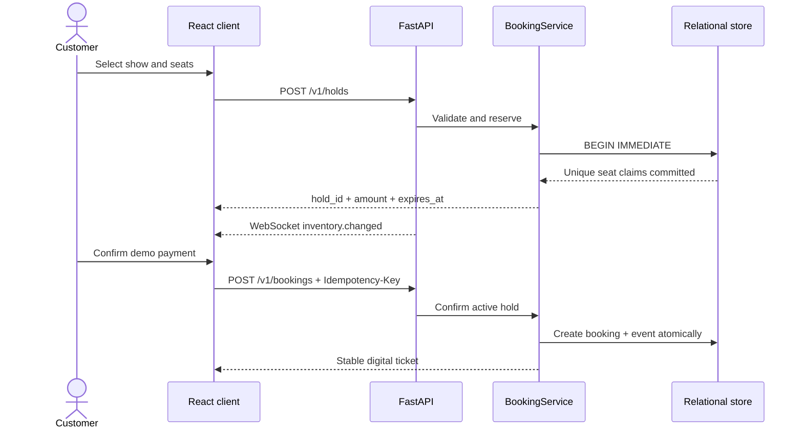

<div align="center">

# BookMyMovie

### Real-time cinema discovery, seat reservation, checkout, and ticketing

[](https://github.com/haarikaalla/Movie-Ticket-Booking/actions/workflows/ci.yml)


**A production-minded full-stack booking platform built around the hardest part of ticketing: maintaining correct inventory while customers compete for the same seats.**

</div>

---

## Why this project matters

BookMyMovie is not a static booking form. It is a complete transaction workflow with a responsive customer application, versioned API, relational domain model, live inventory events, expiring reservations, tiered pricing, simulated payment confirmation, and automated delivery gates.

It handles the failure cases that make real booking systems difficult:

- two customers attempting to reserve the same seat;
- abandoned checkouts blocking inventory indefinitely;
- payment retries creating duplicate bookings;
- stale seat maps during high-demand sales;
- invalid selections and malformed client input;
- frontend and backend contracts drifting apart.

## Product experience

The React application supports the full customer journey:

1. Discover a curated catalogue and search by title or genre.
2. Compare theatres, formats, showtimes, ratings, languages, and prices.
3. Open a live auditorium map with Classic, Prime, and Recliner tiers.
4. Select up to ten seats with immediate server-owned pricing.
5. Protect the selection behind a five-minute checkout hold.
6. Choose a simulated UPI, card, or wallet payment experience.
7. Receive a digital ticket with booking and payment references.

The interface is responsive across desktop and mobile and includes loading, conflict, empty, and error states.

> Payment is intentionally simulated. No card or UPI data is collected and no real funds are moved.

## Architecture



### Booking lifecycle



## How the frontend, APIs, and backend work together

The booking experience is driven by real API calls. The React application never modifies inventory directly; it asks the FastAPI backend to perform each operation, and the backend treats the database as the source of truth.

| Customer action | Frontend request | Backend responsibility | Result returned to the UI |
| --- | --- | --- | --- |
| Opens the application | `GET /v1/catalogue` | Reads movies, theatres, formats, prices, and showtimes | Searchable film catalogue |
| Chooses a show | `GET /v1/shows/{id}/seats` | Expires stale holds and calculates every seat's status, tier, and price | Authoritative live seat map |
| Keeps the seat map open | `WS /v1/shows/{id}/events` | Publishes an event whenever a hold or booking changes inventory | Other open clients refresh automatically |
| Selects seats and continues | `POST /v1/holds` | Starts a transaction, validates the show and seats, claims inventory, and creates a five-minute hold | Hold ID, selected seats, total amount, and expiry time |
| Leaves checkout | `DELETE /v1/holds/{id}` | Releases the active hold and returns its seats to inventory | Released checkout state |
| Confirms payment | `POST /v1/bookings` with `Idempotency-Key` | Revalidates the hold, calculates the server-owned total, creates the booking and audit event atomically | Confirmed digital ticket and payment reference |
| Opens a ticket later | `GET /v1/bookings/{id}` | Reads the persisted booking, show, theatre, and seat records | Stable ticket details |

### Example booking interaction

The frontend first asks the backend to protect the selected seats:

```http
POST /v1/holds
Content-Type: application/json

{
  "show_id": 3,
  "customer_id": "viewer@example.com",
  "seat_numbers": [17, 18]
}
```

The backend responds with an expiring reservation and the authoritative price:

```json
{
  "hold_id": "b8be1675-6a5b-4b60-b06a-e32c97b897ec",
  "show_id": 3,
  "seats": [
    {"number": 17, "label": "C1", "tier": "Classic", "price": 220},
    {"number": 18, "label": "C2", "tier": "Classic", "price": 220}
  ],
  "amount": 440,
  "expires_at": "2026-10-20T15:05:00+00:00",
  "status": "active"
}
```

Checkout then confirms that hold using an idempotency key:

```http
POST /v1/bookings
Content-Type: application/json
Idempotency-Key: checkout-attempt-1001

{
  "hold_id": "b8be1675-6a5b-4b60-b06a-e32c97b897ec",
  "payment_method": "upi"
}
```

If the browser retries this request, the backend returns the original booking instead of creating a second ticket. The confirmed seats remain unavailable and every connected seat map receives an `inventory.changed` WebSocket event.

> The ticket-booking workflow, database writes, inventory protection, totals, and digital ticket are fully implemented. Only the external payment provider is simulated, so the project can be demonstrated safely without collecting financial information.

## Engineering highlights

| Concern | Implementation | Why it matters |
| --- | --- | --- |
| Double-booking prevention | Transaction plus unique `(show_id, seat_number)` constraint | Correctness is enforced at the database boundary |
| Checkout reservations | UUID hold with UTC expiry | Customers receive a protected purchase window |
| Inventory recovery | Automatic expired-hold cleanup | Abandoned checkouts return seats to inventory |
| Safe payment retry | Idempotency key bound to one hold | Retries never create duplicate tickets |
| Live availability | Show-scoped WebSocket channel | Open clients refresh when inventory changes |
| Tiered pricing | Server-owned seat price calculation | The browser cannot define the amount it pays |
| API safety | Pydantic contracts and consistent 4xx errors | Invalid data is rejected before domain execution |
| Auditability | Immutable confirmation event | Important transitions have an evidence trail |
| Production delivery | Multi-stage build and non-root runtime | One container serves the optimized UI and API |
| Quality gates | Python and TypeScript test/build jobs | Both application layers are checked in CI |

## Technology stack

**Frontend:** React 19, TypeScript 6, Vite 8, native WebSockets, responsive CSS, Vitest.

**Backend:** Python 3.11+, FastAPI, Pydantic v2, SQLite transactions, OpenAPI, pytest, HTTPX, Ruff.

**Delivery:** Docker multi-stage build, non-root runtime, health check, persistent volume, GitHub Actions.

## Quick start

### Production-style preview

```bash
docker compose up --build
```

Then open:

- application: <http://localhost:8000>
- API documentation: <http://localhost:8000/docs>
- health endpoint: <http://localhost:8000/health>

The service initializes its schema and demo catalogue automatically. Data persists in the `booking-data` Docker volume.

### Local development

Backend:

```bash
python -m venv .venv
source .venv/bin/activate          # Windows: .venv\Scripts\activate
pip install -e '.[dev]'
uvicorn bookmymovie.api:app --reload
```

Frontend, in another terminal:

```bash
cd frontend
npm install
npm run dev
```

Vite runs at <http://localhost:5173> and proxies API calls to port `8000`.

## API surface

| Method | Endpoint | Purpose |
| --- | --- | --- |
| `GET` | `/health` | Runtime health and service version |
| `GET` | `/v1/catalogue` | Searchable, city-filtered films and shows |
| `GET` | `/v1/shows/{id}/seats` | Priced live seat map |
| `GET` | `/v1/shows/{id}/availability` | Available seat numbers |
| `WS` | `/v1/shows/{id}/events` | Inventory change notifications |
| `POST` | `/v1/holds` | Atomically reserve one to ten seats |
| `GET` | `/v1/holds/{id}` | Retrieve authoritative checkout state |
| `DELETE` | `/v1/holds/{id}` | Release a checkout immediately |
| `POST` | `/v1/bookings` | Confirm with an `Idempotency-Key` |
| `GET` | `/v1/bookings/{id}` | Retrieve a digital ticket |

## Data integrity

The relational schema makes business invariants enforceable:

- shows, holds, bookings, and events have valid parent records;
- a seat can occur only once per show while held or booked;
- each hold and each idempotency key can produce at most one booking;
- status values, ratings, prices, durations, and seat counts are constrained;
- SQLite uses `BEGIN IMMEDIATE` for inventory mutations so competing writers cannot reserve the same seat.

The domain contract can later move to PostgreSQL row locking without changing the customer-facing API.

## Testing

```bash
ruff check src tests
pytest

cd frontend
npm test
npm run build
```

The current suite has **13 passing tests** across backend and frontend. Coverage includes catalogue grouping, seat tiers and pricing, conflicting holds, idempotent confirmation, idempotency misuse, hold release, invalid selections, API errors, the complete customer journey, and frontend price calculation.

## Repository structure

```text
.
├── frontend/
│   ├── src/
│   │   ├── App.tsx             # complete customer journey
│   │   ├── api.ts              # typed API client
│   │   ├── types.ts            # frontend domain types
│   │   └── styles.css          # responsive visual system
│   └── vite.config.ts          # development proxy + production build
├── src/bookmymovie/
│   ├── api.py                  # REST routes, WebSockets, SPA delivery
│   ├── database.py             # schema and migration compatibility
│   └── service.py              # catalogue, inventory, checkout, ticketing
├── tests/                      # domain and end-to-end API tests
├── .github/workflows/ci.yml    # frontend and backend CI jobs
├── Dockerfile                  # multi-stage non-root image
└── docker-compose.yml          # one-command deployment
```

## Production evolution

The implementation deliberately keeps infrastructure local and reviewable. A larger deployment would retain the same API and invariants while adding PostgreSQL row locking, Redis expiry workers, a signed payment webhook, OIDC authentication, transactional outbox events, OpenTelemetry traces, Prometheus metrics, load tests, and horizontally scaled API instances.

## License

Released under the [MIT License](LICENSE).
